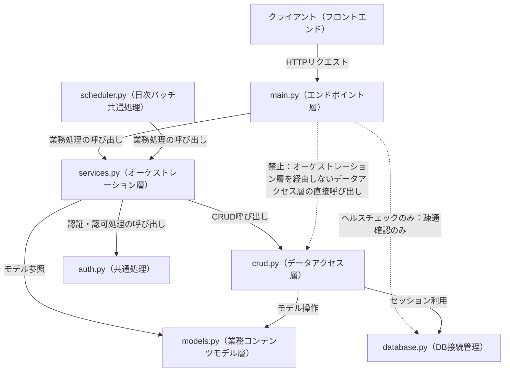

# アーキテクチャ方針

- **工程**: 設計工程
- **作成者**: Claude Sonnet 5
- **作成日**: 2026-10-08
- **最終更新日**: 2026-10-08

---

## ○概要

### 目的
- バックエンド（FastAPI）のレイヤー構成と、レイヤー間の呼び出し方向を定める。
- 設計・実装・単体テスト・結合テストの各工程で共通して用いる機能群の分割を定める。

### 対象範囲
- `backend/app/`配下の全モジュール（`main.py`・`services.py`・`crud.py`・`auth.py`・`models.py`・`schemas.py`・`database.py`・`scheduler.py`）。
- `設計書/`・`test_specification/`配下の機能群単位のフォルダ分割。

---

## ○構成

| 要素 | 役割 | 対応ファイル・ディレクトリ |
|---|---|---|
| エンドポイント層 | HTTPリクエストの受付・バリデーション結果の受領・オーケストレーション層の呼び出し・レスポンス返却 | `backend/app/main.py` |
| オーケストレーション層 | 業務処理（状態遷移・二重貸出判定・通知生成等）の実行、データアクセス層・共通処理・業務コンテンツモデル層の呼び出し | `backend/app/services.py` |
| データアクセス層 | DBへのCRUD操作 | `backend/app/crud.py` |
| 共通処理（認証・認可） | パスワードハッシュ化・検証、JWT発行・検証、有効ユーザー検証、権限検証 | `backend/app/auth.py` |
| 業務コンテンツモデル層 | テーブルモデル（データ構造）の定義 | `backend/app/models.py` |
| API入出力DTO | リクエスト・レスポンスのスキーマ定義（Pydantic） | `backend/app/schemas.py` |
| DB接続管理 | DBセッションの生成・提供 | `backend/app/database.py` |
| 日次バッチ共通処理 | 返却期限通知・ノーショー自動取消の定期実行 | `backend/app/scheduler.py` |

---

## ○ルール

以下は`design`スキルの「レイヤー構成」を一次情報とし、本プロジェクトでの適用を定める（原文は`.claude/skills/design/SKILL.md`「## レイヤー構成」を参照）。

- レイヤー間の呼び出しは、エンドポイント層→オーケストレーション層→データアクセス層／共通処理／業務コンテンツモデル層の一方向のみとし、下位レイヤーから上位レイヤーを呼び返さない。
- エンドポイント層は下位レイヤーを直接呼び出さず、必ずオーケストレーション層を経由する。例外は、ヘルスチェック（DB等への疎通確認のみを行う処理）に限る。
- ヘルスチェック以外は、単純な参照等、業務処理を持たない処理も例外としない。下位レイヤーを呼ぶだけの場合も、オーケストレーション層に中継する処理を置いて経由する。
- `scheduler.py`（日次バッチ）はオーケストレーション層（`services.py`）のみを呼び出し、`crud.py`を直接呼び出さない（バッチ起動の起点をエンドポイント層と同様に扱う）。
- リクエスト・レスポンスのスキーマ（`schemas.py`）は物理名で記載する。メソッド呼び出しの引数は論理名のみを記載し、物理名は実装時に当該メソッドの設計書の引数定義と紐づけて特定する。
- データアクセス層（`crud.py`）のレスポンスはモデル（`models.py`）をそのまま返却し、設計書にはクラス名のみを記載する（項目名は記載しない）。
- オーケストレーション層（`services.py`）は、データアクセス層のレスポンスから必要な項目のみを使用し、エンドポイント層へ返却する。エンドポイント層はオーケストレーション層のレスポンスをそのままクライアントへ返却する。
- 認証エラーは401、権限エラーは403とする。他人の申請への操作は、対象の存在有無を判別できないよう「対象なし」と同様の404として扱う（要件定義書/機能要件「アクセス制御」参照）。

---

## ○対応状況

設計・実装・単体テスト・結合テストの各工程における機能群の分割は、以下の区分に従う（`作業管理ルール.md`「バックログの分割単位」参照。以降の工程でも同じ区分を用いる）。

| 区分 | 意味 |
|---|---|
| 認証・ユーザー管理 | ログイン・ログアウト、パスワード変更、ユーザー登録・編集・無効化を扱う |
| 備品管理 | 備品の検索・予約状況確認・登録・編集・無効化・CSV一括登録を扱う |
| 貸出申請・承認 | 貸出申請・取消・自分の申請状況確認・通知確認・承認却下・管理者取消を扱う |
| 貸出・返却・履歴 | 貸出処理・返却処理・期限超過一覧確認・貸出履歴閲覧・CSV出力を扱う |

| 区分 | 対象（機能一覧の機能No） | 備考 |
|---|---|---|
| 認証・ユーザー管理 | F01, F02, F16 | - |
| 備品管理 | F03, F04, F14, F15 | - |
| 貸出申請・承認 | F05, F06, F07, F08, F09, F12 | 通知確認（F08）は、通知の大半が申請の状態遷移（承認・却下・取消）に起因するため本区分に含める |
| 貸出・返却・履歴 | F10, F11, F13, F17 | 返却期限通知の生成はservices.py内で本区分からNOTIFICATIONのデータアクセス層（共通）を呼び出す |

---

## ○根拠・関連資料

- 機能一覧・機能要件：[要件定義書/機能一覧_v1.0.0.md](../要件定義書/機能一覧_v1.0.0.md)、[要件定義書/機能要件_v1.0.0.md](../要件定義書/機能要件_v1.0.0.md)
- レイヤー構成の一次情報：`design`スキル「## レイヤー構成」
- 機能群・バックログ分割の一次情報：`作業管理ルール.md`「バックログの分割単位」
